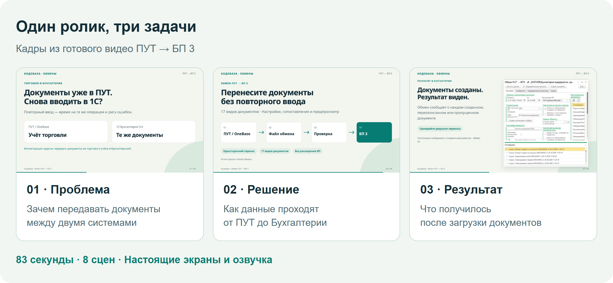
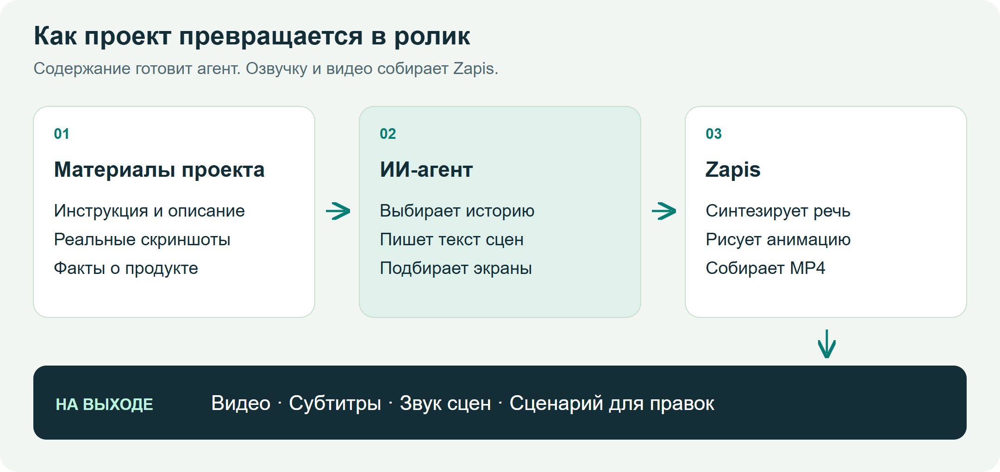
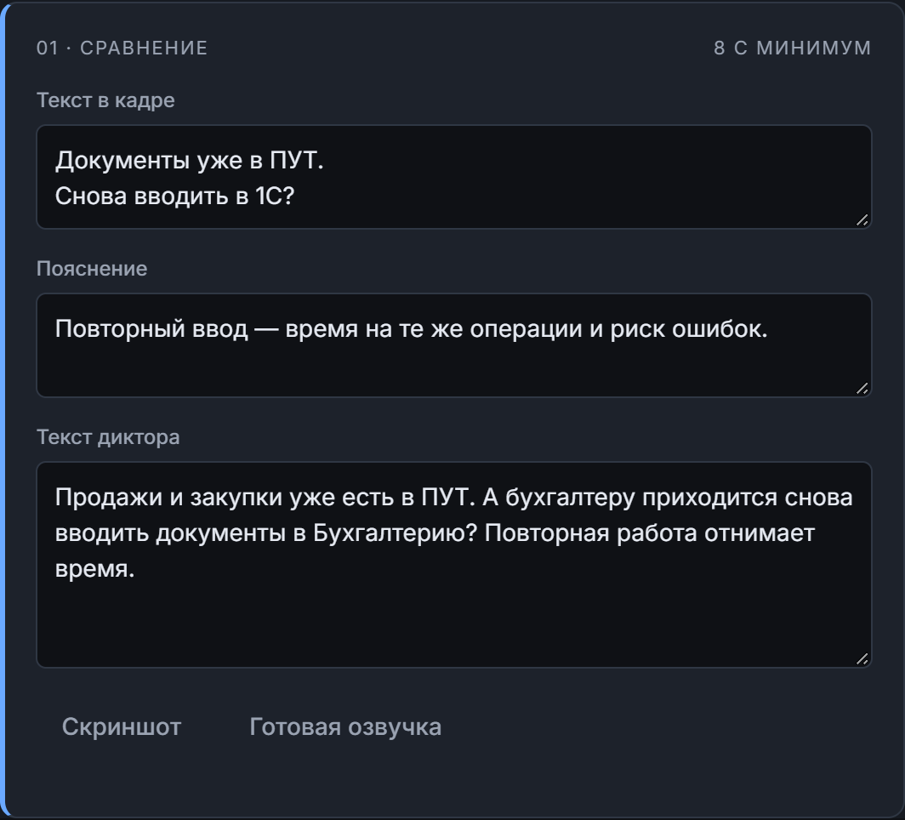
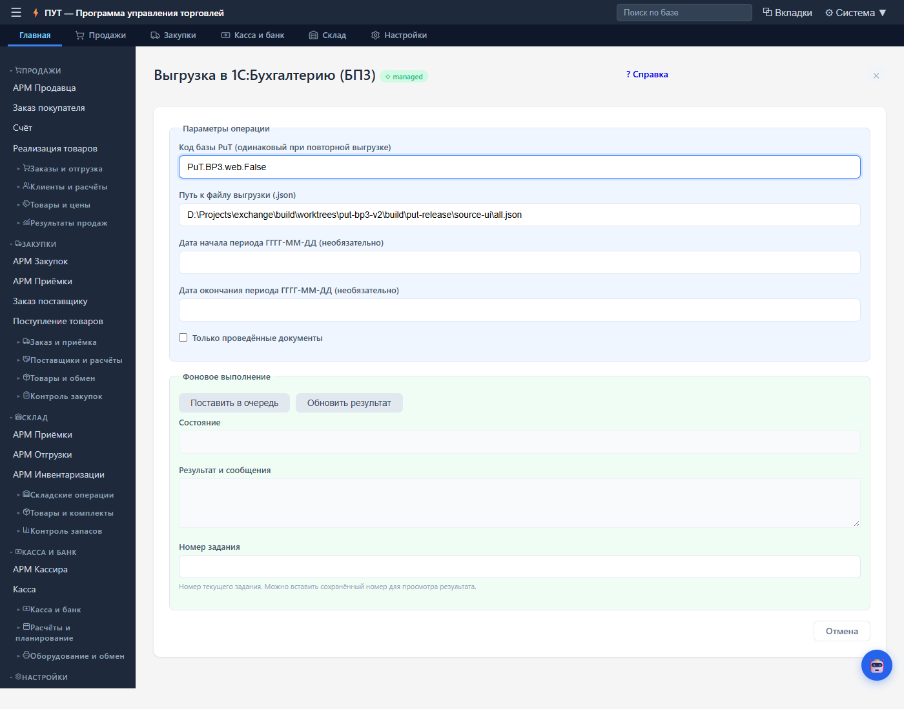
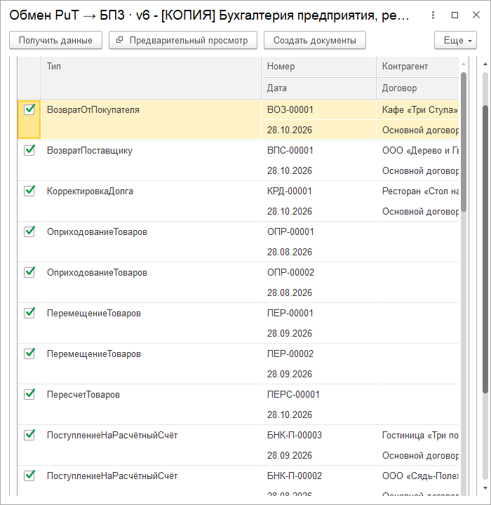
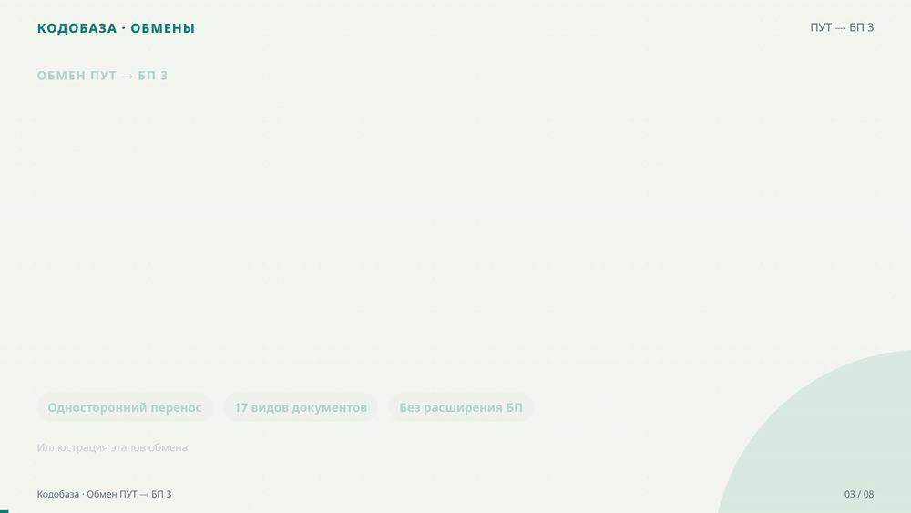
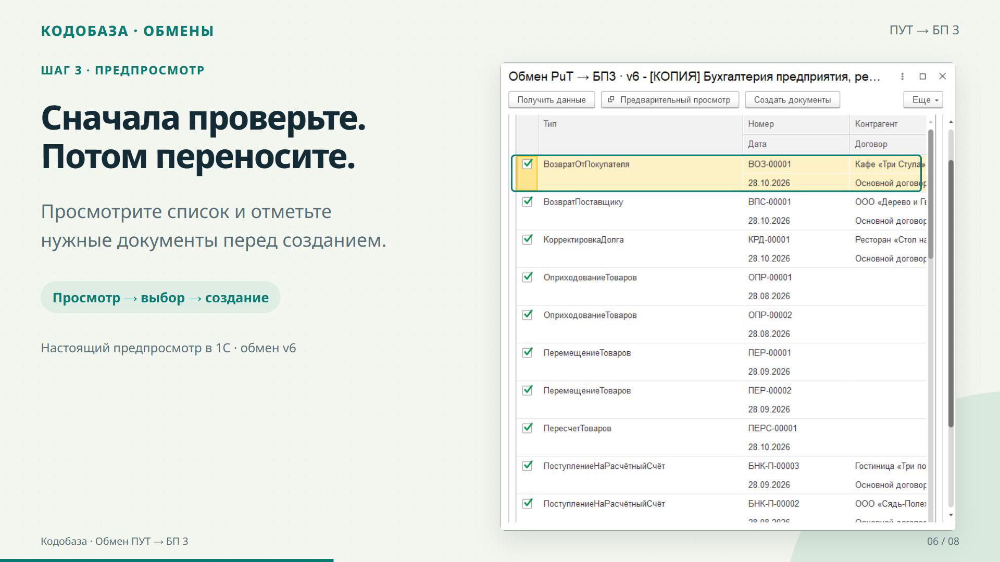

# Как я расширил «Запись»: маркетинговые ролики из проекта, скриншотов и озвучки

В [предыдущей статье о «Записи»](https://infostart.ru/1c/articles/2748070/) я рассказывал о приложении для работы с речью и текстом. Озвучка там уже была: загружаешь текст, выбираешь голос и получаешь аудио. Когда мне понадобились короткие ролики для карточек своих разработок, решил использовать эту возможность ещё раз. Добавить к речи настоящие экраны программы, подписи и анимацию, затем собрать всё в видео.

Поводом стал [ролик о создании маркетинговых видео с Claude Design](https://www.youtube.com/watch?v=oWbUL_TZm_4). Мне понравилась сама идея: показать продукт через короткую историю с движением и голосом. У меня уже работал синтез речи в Zapis. На его основе я стал собирать свой конвейер, в котором материалы остаются рядом с проектом и ролик можно пересобрать после правки.

## Сначала покажу результат

Для примера взял обмен ПУТ на OneBase → 1С:Бухгалтерия 3.0. Получился горизонтальный ролик на 83 секунды: восемь сцен, реальные экраны обеих программ, анимированная схема и озвучка. Он уже размещён в [карточке обмена на Кодобазе](https://codebaza.ru/solutions/put-bp3/).

*Один пример на протяжении всей статьи. Сначала объясняю задачу, затем показываю способ решения и результат. Это кадры из готового MP4, собранные в ленту для сравнения.*

Полный ролик можно посмотреть в карточке или [открыть отдельным MP4](https://codebaza.ru/media/exchanges/put-bp3/overview.mp4). Ниже разберу, откуда взялись его содержание, экраны и движение.

## Что добавилось к готовой озвучке

У «Записи» уже был выбор движка и голоса, синтез речи и работа со звуковыми файлами. Для видео понадобился ещё один слой: описание сцен, изображения, длительность показа, подписи и правила появления элементов.

Содержание готовит ИИ-агент. Он изучает проект, выбирает, что показать, и пишет текст диктора. Затем вызывает Zapis. Приложение использует свои механизмы озвучки, а кадры и движение собираются через Remotion. Этот движок позволяет описывать анимацию кодом на React.

*Схема устройства конвейера. Агент отвечает за содержание, Zapis за озвучку и сборку. Скриншоты приходят из работающего продукта.*

Монтаж выполняется на компьютере. Синтез речи может быть локальным или сетевым, в зависимости от выбранного движка. Для повторного рендера сохранённого сценария работа языковой модели не обязательна.

## Для начала достаточно папки и одного запроса

В папке обмена были инструкция, сведения о выпуске и настоящие скриншоты. Их и использовали для ролика. Мой запрос можно сформулировать так:

> Сделай рекламный ролик про обмен ПУТ → БП 3 из этой папки на 60–90 секунд. Покажи проблему и решение, используй готовые скриншоты подходящей версии. Добавь понятную анимацию и озвучку.

Агент читает материалы, составляет историю, подбирает изображения и сохраняет рабочий сценарий. Пользователю не нужно отдельно заполнять бриф, писать JSON или запускать несколько команд по очереди. Технические этапы описаны во внутренних инструкциях агента.

Сценарий можно открыть и поправить в самом приложении. В редакторе отдельно хранятся короткий текст в кадре и фраза диктора. Там же выбираются голос, формат и качество сборки.

*Настоящая карточка сцены в Zapis с материалами ПУТ. Подпись и речь редактируются отдельно. Можно поправить их вручную, даже если первоначальный сценарий подготовил агент.*

## История важнее перечня возможностей

Для карточки продукта легко написать набор фраз: «удобно», «гибко», «много настроек». Из них трудно понять, что именно получит покупатель. Поэтому сначала определяю задачу зрителя, потом выбираю экран, который подтверждает решение.

В примере ПУТ торговые документы уже находятся в одной системе, а бухгалтерский учёт ведётся в другой. Ролик объясняет, как передать данные и проверить их перед загрузкой. Зритель видит выгрузку, настройки Бухгалтерии, предпросмотр и сообщения о созданных документах.

| Часть истории | Что нужно объяснить | Чем подтверждаю |
| --- | --- | --- |
| Проблема | Документы из торгового учёта нужны в Бухгалтерии | Короткая постановка задачи и экран ПУТ |
| Решение | Данные можно передать через файл и проверить до загрузки | Схема, параметры выгрузки и настоящий предпросмотр |
| Результат | После загрузки понятно, что произошло с документами | Сообщения загрузчика из демонстрационной базы |

Такой порядок помогает и при подготовке текста. У каждой сцены появляется задача. Если кадр не объясняет действие и не подтверждает результат, его можно сократить или убрать.

## Откуда взялись скриншоты

Для этого ролика экраны уже были подготовлены в материалах выпуска v6. Агенту оставалось выбрать подходящие. В видео использованы настоящий интерфейс OneBase и формы загрузчика в Бухгалтерии, включая предпросмотр и сообщения о результате.

*Исходный экран OneBase. Он показывает, где задаётся период и запускается выгрузка. Этот снимок передаётся в ролик как изображение.*

*Исходный экран 1С. Виден список документов, которые можно отметить перед созданием. Это работающая форма, её содержимое не рисовалось для рекламы.*

Сначала агент ищет готовые снимки и проверяет, подходят ли они к текущей версии. Если нужного кадра нет, он может сделать его при наличии доступа к приложению. Для сайта используется браузер, для 1С нужна доступная демонстрационная база и инструменты работы с клиентом. Если доступа нет, агент уточняет, какой экран требуется. Сам Zapis получает готовые изображения и использует их при сборке.

Схемы и графику можно придумать и нарисовать. Снимок продукта должен показывать то, что действительно существует в его интерфейсе. Это особенно заметно в кадре предпросмотра: рекламной подписи недостаточно, зрителю нужно увидеть сам список.

## Анимация объясняет переходы

В сцене со схемой узлы появляются последовательно: ПУТ, файл обмена, проверка, Бухгалтерия. Пока диктор объясняет следующий шаг, на экране раскрывается соответствующая часть пути. Ниже фрагмент готового ролика, а не отдельная демонстрация другого продукта.

*Короткий GIF из сцены со схемой. В полном MP4 этот фрагмент сопровождается голосом.*

В Remotion положение, прозрачность и появление элемента зависят от номера кадра. Поэтому можно сделать движение стрелок, подсветку этапа, появление карточек и плавное приближение к скриншоту. У длинной таблицы оставляю время на чтение, а переход между системами объясняю схемой.

Для ролика ПУТ макет дополнительно подстроили под конкретные экраны в отдельной рабочей копии рендера. Это часть работы с кодом и компоновкой. Базовые сцены уже дают готовые приёмы, а для другой композиции агент может доработать шаблон. Такие изменения стоит сохранять вместе с проектом ролика, чтобы следующая сборка воспроизводила тот же вид.

## Короткая подпись, подробное объяснение голосом

В сцене предпросмотра на экране написано: «Сначала проверьте. Потом переносите». Диктор объясняет, что видно в списке и какое действие выполнить после проверки. Голос и подпись дополняют друг друга, таблицу не приходится закрывать длинным абзацем.

*Тот же предпросмотр внутри готовой видеосцены. Рамка и подписи добавлены при сборке, сам снимок формы остаётся исходным.*

Речь для сцен создаётся отдельно. Длительность показа учитывает фактическую длину аудио, поэтому переход не обрывает фразу диктора. Для сложного названия или сокращения можно изменить произносимый текст, сохранив привычное написание в кадре.

Перед финальной сборкой полезно просмотреть раскадровку и прослушать фрагмент. Читаемость скриншота, темп речи и продолжительность сцены проверяются по отдельности. После сборки смотрю сам MP4 со звуком и перемоткой.

## Что остаётся для следующей правки

В рабочей папке сохраняются сценарий, изображения, озвучка сцен, готовое видео и субтитры. Поэтому можно вернуться с обычной просьбой: «Сделай предпросмотр крупнее», «Убери это обещание» или «Замедли сцену с результатом».

После изменения обработки достаточно обновить соответствующий снимок и текст. Для моих карточек это даёт возможность делать серию роликов в одном оформлении и постепенно улучшать их подачу.

Исходники и инструкции находятся в [репозитории Zapis](https://github.com/ivanarama/zapis/tree/feature/marketing-video-pipeline). После однократной настройки можно работать через редактор или поручить подготовку агенту с подключённым навыком из репозитория. Для другого продукта меняются материалы и история, способ сборки остаётся тем же.
