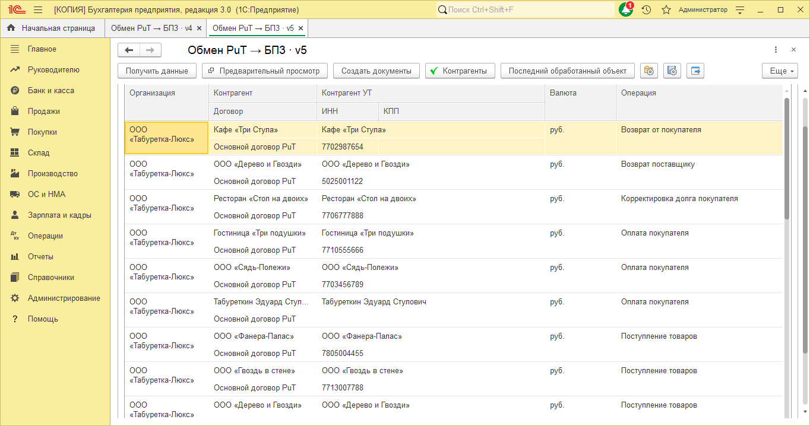
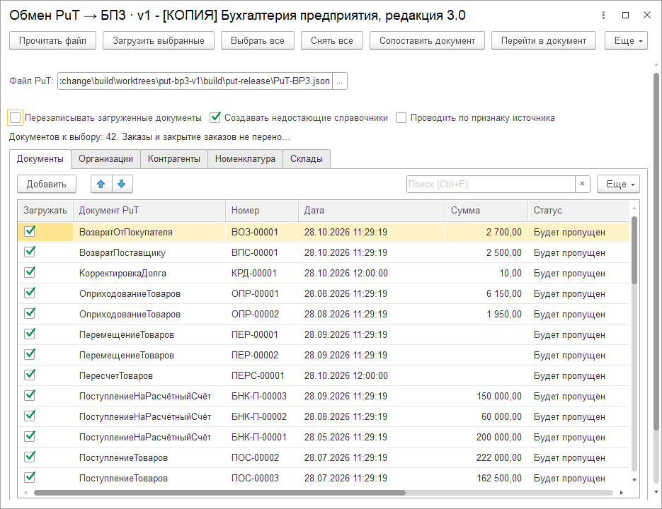

# ИИ готовит ролик о продукте, Zapis собирает видео: сценарий, реальные экраны и голос

Для карточек своих обработок мне понадобились короткие ролики. Хотелось показать задачу пользователя, способ решения и настоящий экран программы. Затем собрать из этих же материалов горизонтальную версию для сайта и вертикальную для коротких публикаций.

Отправной точкой стал [ролик о создании продающих видео и анимаций в Claude Design](https://www.youtube.com/watch?v=oWbUL_TZm_4). В нём автор показывает работу через диалог, анимацию схем и несколько типов продуктовых видео. Мне оказался нужен процесс, в котором можно заменить экран или фразу и повторить сборку с сохранёнными настройками.

Содержание ролика готовит ИИ-агент: читает материалы продукта, выделяет проблему покупателя, пишет текст диктора и выбирает реальные экраны. Затем агент вызывает [Zapis](https://github.com/ivanarama/zapis) через командный интерфейс. Zapis синтезирует речь, рассчитывает длительность сцен и собирает MP4 с анимацией Remotion.

Для пользователя работа начинается с одного сообщения: «Сделай минутный ролик о проекте из этой папки. Покажи проблему и решение, настоящие экраны, добавь анимацию и озвучку». Отдельный бриф и сценарий вручную готовить не нужно. Агент сохраняет рабочие материалы сам, а следующую правку можно попросить таким же обычным сообщением.

Так разделены две части работы. Агент принимает решения о содержании и подаче, Zapis выполняет озвучку и рендер. При повторной сборке уже сохранённого сценария новый вызов языковой модели не требуется.

## Начинаю с задачи покупателя

Для следующей записи процесса я выбрал обмен ПУТ на OneBase → 1С:Бухгалтерия 3.0. Торговые операции ведутся в ПУТ, бухгалтерские данные нужны в БП. Перед загрузкой важно выбрать состав документов, проверить справочники и понять, что произойдёт с уже перенесёнными документами.

В исходных материалах этого релиза есть инструкция, описание состава, отчёт проверок и настоящие снимки обоих интерфейсов. Агент может опереться на них при подготовке истории: проблема раздельного учёта, выгрузка в OneBase, JSON, предпросмотр в БП и проверка статусов документов.

Для этого примера скриншоты уже подготовлены. В комплекте шесть кадров: два из OneBase и четыре из загрузчика БП v5. Кадры БП сняты заново 29 октября, снимки OneBase взяты из предыдущей проверки неизменившегося экспортёра. Ниже показаны настройки выгрузки и четыре экрана БП. Агент использует подходящие готовые кадры, повторная съёмка нужна при изменении интерфейса или отсутствии нужного экрана.

На экране OneBase видны период, признак проведения и запуск фонового задания. В БП v5 сначала выбираются организации, период и виды документов, затем получаются данные и проверяются сопоставления. Список документов открывается отдельной командой «Предварительный просмотр». Эти кадры объясняют, где пользователь управляет переносом. Анимированные стрелки связывают этапы между такими демонстрациями.

*Реальный экран из проверки выпуска ПУТ → БП 3. В источнике подготавливается выгрузка, предпросмотр документов находится в 1С.*

*Новый кадр v5: файл, организации, период и виды документов выбираются до получения данных.*

*После получения данных проверяются ссылки и договоры. Съёмка выполнена 29 октября с работающим EPF v5.*

*Свежий общий кадр предпросмотра v5. Правая часть со статусами, СФ и операцией вынесена в отдельный кадр комплекта для записи. При этой съёмке документы не создавались.*

*Та же таблица после горизонтальной прокрутки. Здесь читаются статусы «Будет пропущен» для повторного файла и операции документов.*

Для версии 5 заявлены 17 видов документов, заказы и закрытия заказов исключены. По умолчанию загрузчик записывает документы без проведения. Эти границы агент берёт из инструкции и манифеста: их нельзя заменять обещанием перенести и провести любой объект.

## Что агент делает внутри

Из изученных материалов агент составляет JSON-сценарий и собирает изображения в рабочую папку рядом с проектом. У сцены есть тип, минимальная длительность, заголовок, пояснение и текст диктора. Текст в кадре может быть коротким, а голос объясняет подробности. Пользователю не нужно знать названия полей или заполнять их.

Поле evidence хранит источник утверждения. Для ПУТ → БП 3 это инструкция, манифест версии и отчёт проверки, для другого продукта может быть авторская публикация. Поле помогает вернуться к исходным материалам при правке сценария. Само наличие ссылки не доказывает рекламное обещание, содержание всё равно проверяет человек.

В интерфейсе можно править основные тексты и загружать скриншоты. Дополнительные поля доступны в JSON: цвет, элементы схемы, шаги, сравнение двух вариантов и моменты появления revealAt. Сценарий можно сохранить файлом и открыть снова.

Структуру сцен и ограничения по длине агент получает из самого конвейера. Факты он ищет в проекте, а недостающий доступ к приложению уточняет у автора. Встроенный режим видео принимает сохранённый сценарий и не требует платного вызова LLM для каждой повторной сборки.

Для работы из диалога добавлены командный интерфейс Zapis и навык zapis-video. Это внутренние инструкции агента: выбирать навык или запускать этапы вручную пользователю не требуется. Агент проверяет сценарий, доступность голоса и читаемость кадров, затем собирает ролик. Zapis возвращает ID задания и пути к файлам, поэтому длительную сборку можно продолжить после завершения ожидания.

## Скриншоты остаются настоящими

Для ПУТ → БП 3 подготовлен комплект реальных изображений с указанием выпуска, происхождения и контрольных сумм. Часть кадров взята из проверки выпуска, часть снята заново с загрузчиком v5. Контрольные суммы позволяют проверить, что пиксели не изменились. Программа вписывает снимки в кадр и добавляет плавное появление и небольшой зум. Содержимое интерфейса остаётся исходным.

Сначала агент ищет готовые снимки и проверяет их соответствие версии продукта. Если нужного кадра нет, он может открыть доступное приложение и сделать скриншот. Для сайта подходит браузер, для 1С нужен доступ к демонстрационной базе. Если такого доступа нет, агент запрашивает конкретный снимок или возможность открыть приложение. Сам Zapis не управляет 1С и не снимает её интерфейс, он использует переданные изображения.

Схему обработки данных я показываю отдельной сценой. Там можно двигать узлы, проводить соединения и подсвечивать этапы. В кадре со сравнением указывается, что это иллюстрация. Так зритель может отличить объясняющую графику от экрана работающего продукта.

## Голос выбирается до рендера

Главный урок первого варианта: технически исправная аудиодорожка ещё не означает хорошую озвучку. Голос может быть слышен, но читать фразу неприятно. В новой вкладке сначала создаётся короткая проба на выбранном тексте. Несколько проб остаются рядом, их можно прослушать и выбрать подходящий вариант.

Используются существующие движки Zapis. Silero и Piper работают локально после загрузки моделей. Edge обращается к сетевому сервису. Яндекс SpeechKit и Сбер SaluteSpeech используют настройки и ключи из раздела озвучки. Облачный синтез оплачивается по условиям выбранного провайдера.

При проверке обнаружилась отдельная проблема: закреплённая версия edge-tts 7.2.8 получала HTTP 403. После обновления до 7.3.1 удалось получить речь голосом Светланы. В [истории выпусков edge-tts](https://github.com/rany2/edge-tts/releases) указаны изменения протокола подключения. Доступность отдельного голоса всё равно проверяется пробой, сетевой сервис может отказать.

Озвучка каждой сцены создаётся отдельно. Числа и сокращения можно развернуть перед синтезом. Для Silero доступна расстановка ударений ruaccent. У Piper регулируется длительность речи. Если конкретное название звучит плохо, проще исправить текст диктора и прослушать эту фразу ещё раз. Можно также загрузить собственную озвучку сцены в WAV.

Пустой ответ, нечисловые отсчёты или тишина останавливают сборку с ошибкой. Этот контроль не оценивает красоту голоса и правильность ударения, он отсекает технически негодную дорожку. Качество речи я проверяю на слух.

## Как устроены анимации

Кадры рисует Remotion на React. Положение элементов зависит от номера кадра. Заголовок появляется по словам, схема раскрывается по узлам, соединительная линия проходит между этапами. Есть последовательное появление карточек и шагов, счётчик, сетка на фоне и плавное движение акцента.

В ролике о ПУТ анимация связывает четыре этапа: OneBase → JSON → предпросмотр БП → загрузка. Когда диктор переходит к следующему действию, появляется соответствующий узел схемы. Затем реальный скриншот показывает настройки или список документов. На предпросмотре движение замедляется, чтобы зритель успел прочитать суммы и статусы. Это замысел сцен для предстоящей сборки, готовый ролик по этому примеру я покажу после записи процесса.

| Сцена | Что она показывает |
| --- | --- |
| screenshot | Настоящий экран продукта с подписью |
| flow | Этапы процесса и соединения между ними |
| steps | Короткую последовательность действий |
| compare | Два подписанных варианта с пояснением |
| title | Основную мысль в начале или между разделами |
| cta | Предложение продукта и способ обратиться |

Длительность сцены подстраивается под фактическую длину речи. Минимальное время из сценария сохраняется, если диктор прочитал фразу быстрее. Подвижные элементы можно привязать к секундам revealAt. Субтитры формируются по границам сцен, пословной синхронизации здесь пока нет.

## Сначала раскадровка, затем MP4

Кнопка «Раскадровка» собирает по одному кадру каждой сцены без синтеза речи. Здесь проверяю заголовки, размер скриншота и последовательность истории. Затем выбираю качество и запускаю ролик с голосом.

Доступны горизонтальный и вертикальный форматы, можно собрать оба за один запуск. Для проверки есть уменьшенная версия с 12 кадрами в секунду. Финальный режим выдаёт 1080p с 24 кадрами в секунду. Громкость готового звука выравнивается, видеопоток при этом копируется без повторного кодирования.

Каждая сборка получает отдельную папку. Сохраняются снимок сценария, исходные экраны, озвучка сцен, MP4, SRT/VTT, параметры и хеши файлов. Это позволяет проверить, из каких материалов получился результат. Старые сборки остаются в истории после следующего запуска.

## Как повторить

Для режима видео нужен запуск Zapis из исходников, Python 3.11 или 3.12, Node.js 22+ и Chromium, Chrome или Edge. Рабочий код CLI и генератора находится в [ветке feature/marketing-video-pipeline](https://github.com/ivanarama/zapis/tree/feature/marketing-video-pipeline), она может отличаться от готовых исполняемых релизов. В Windows установка вынесена в PREPARE-VIDEO.cmd, открытие приложения в START-VIDEO.cmd. Голосовую модель лучше загрузить и проверить до записи демонстрации.

Для записи процесса достаточно открыть папку готового проекта и отправить агенту запрос. В моём примере он выглядит так:

> Сделай ролик ПУТ → БП 3 на 60–90 секунд из последней готовой версии в папке проекта. Покажи проблему и решение, настоящие экраны OneBase и предпросмотра в 1С. Добавь понятную анимацию и озвучку Светланы.

Агент с установленным навыком zapis-video сам находит последний готовый релиз, изучает материалы, сохраняет сценарий в новой папке и запускает сборку. После просмотра можно написать: «Сделай предпросмотр крупнее и замедли этот кадр». Сценарий остаётся для дальнейших изменений. Навык находится в папке skills/zapis-video репозитория, его подключение и установка Zapis нужны один раз.

Процесс применим и к другим продуктам. Укажите другую папку или доступный сайт, сформулируйте задачу зрителя и нужный формат. Для съёмки сайта используется браузер, для 1С нужен доступ к демонстрационной базе. Если приложение недоступно и готовых кадров нет, агент сообщит, какой экран или доступ необходим. Само наличие исходников не гарантирует возможность снять любой интерфейс.

Технические команды оставлены в [справочнике CLI](https://github.com/ivanarama/zapis/blob/feature/marketing-video-pipeline/docs/video/cli.md). Это интерфейс автоматизации для агента и разработчика. Пользователю не требуется проходить его этапы вручную. Без ИИ-агента в Zapis можно работать через редактор сцен.

В репозитории уже есть и другой сценарий: презентация PPT/PPTX и текстовый сценарий превращаются в озвученное видео через backend.slides. Новый режим использует общие TTS-движки и обработку краёв звука из этого конвейера, а анимации и оформление отдаёт Remotion.

Claude Design удобен, когда хочется искать визуальную идею в диалоге и менять её на ходу. [Официальное описание продукта](https://www.anthropic.com/news/claude-design-anthropic-labs) включает комментарии, прямые правки и экспорт. Для серии своих карточек я выбрал сохранённый сценарий, исходные экраны и повторяемую сборку. Голос, темп и анимацию можно проверять по отдельности, затем пересобирать нужные версии ролика.

Перед использованием движка в своей работе нужно учесть [условия Remotion](https://www.remotion.dev/license) и лицензии выбранных голосовых моделей. Сам проект ничего не публикует автоматически: готовый ролик я сначала просматриваю и прослушиваю.
