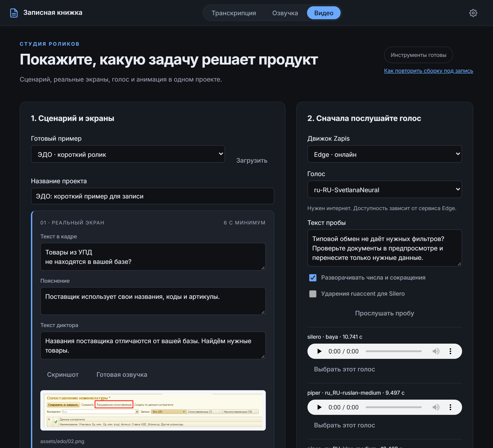
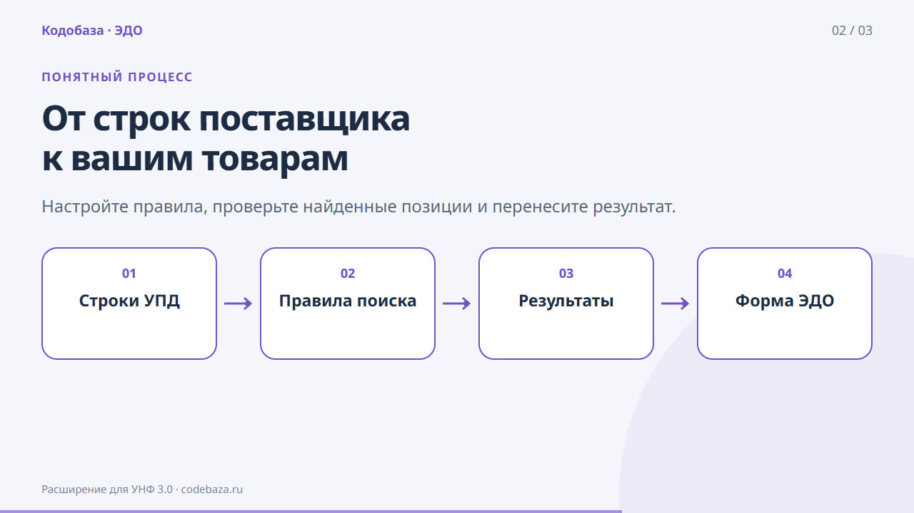
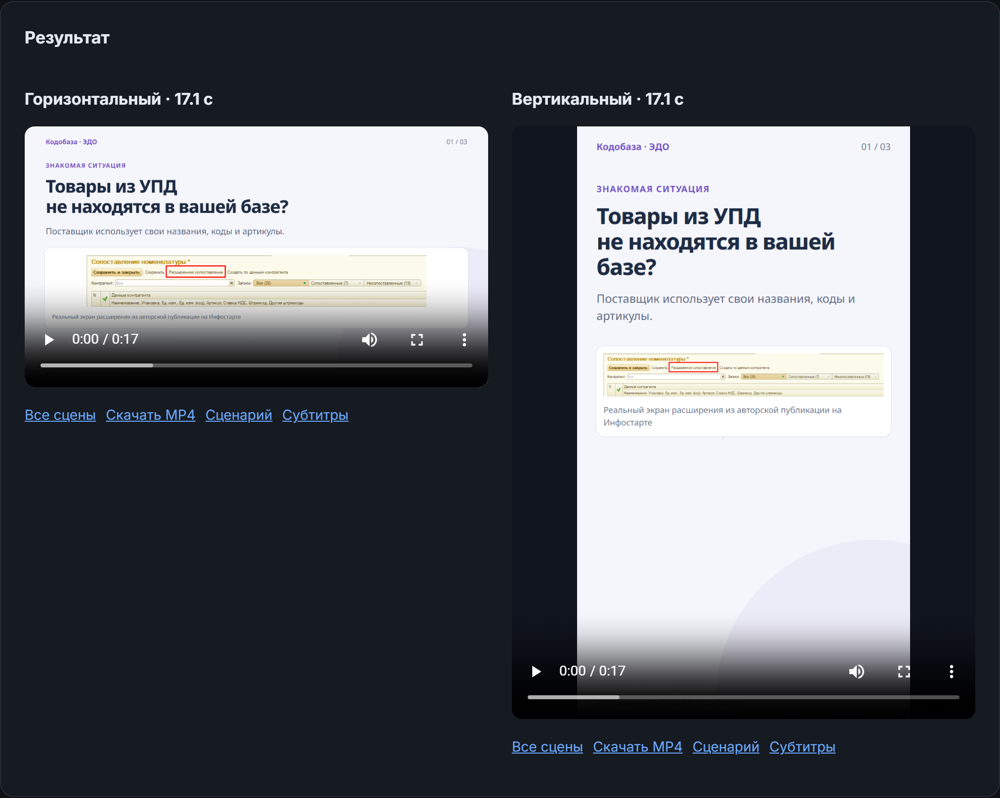

# Маркетинговые ролики в Zapis: реальные экраны, анимация и выбор голоса

Для карточек своих обработок мне понадобились короткие ролики. Хотелось показать задачу пользователя, способ решения и настоящий экран программы. Затем собрать из этих же материалов горизонтальную версию для сайта и вертикальную для коротких публикаций.

Отправной точкой стал [ролик о создании продающих видео и анимаций в Claude Design](https://www.youtube.com/watch?v=oWbUL_TZm_4). В нём автор показывает работу через диалог, анимацию схем и несколько типов продуктовых видео. Мне оказался нужен процесс, в котором можно заменить экран или фразу и повторить сборку с сохранёнными настройками.

Первую версию я сделал отдельным проектом на Remotion. Картинка собиралась, но озвучка системным голосом Windows получилась неудачной. В моём [Zapis](https://github.com/ivanarama/zapis) уже были выбор TTS-движка и работа с голосами. Поэтому конвейер вошёл в этот проект отдельной вкладкой «Видео».



*Рисунок 1. Слева редактируются сцены, справа можно сравнить голоса перед сборкой.*

## Начинаю с задачи покупателя

В коротком примере используется расширение для сопоставления номенклатуры в ЭДО. У поставщика свои названия, коды и артикулы. Пользователь хочет сопоставить строки с товарами своей базы и проверить найденные позиции.

Эту историю я разложил на три сцены. В первой показан реальный экран и сформулирована проблема. Во второй анимированная схема объясняет последовательность: строки УПД, правила поиска, результаты, форма ЭДО. Третья сцена предлагает открыть описание продукта.

Для обменов между конфигурациями история будет другой. Здесь стоит показывать ограничения типовой синхронизации: нужные отборы, предпросмотр, особенности объектов и устойчивость к изменениям конфигураций. Само движение блоков между двумя базами почти ничего не говорит покупателю. У каждого кадра должна быть конкретная мысль.

## Сценарий хранится рядом с проектом

Вход конвейера состоит из JSON-сценария и файлов изображений. У сцены есть тип, минимальная длительность, заголовок, пояснение и текст диктора. Текст в кадре может быть коротким, а голос объясняет подробности. Для скриншота указывается image, для схемы nodes, для шагов steps.

Поле evidence хранит источник утверждения. В примере это ссылка на авторскую публикацию с описанием расширения. Поле помогает вернуться к исходным материалам при правке сценария. Само наличие ссылки не доказывает рекламное обещание, содержание всё равно проверяет человек.

В интерфейсе можно править основные тексты и загружать скриншоты. Дополнительные поля доступны в JSON: цвет, элементы схемы, шаги, сравнение двух вариантов и моменты появления revealAt. Сценарий можно сохранить файлом и открыть снова.

Нейросеть может подготовить такой черновик из описания продукта. Я даю ей исходные факты, структуру сцен и ограничения по длине. После этого проверяю формулировки и подбираю настоящие экраны. Встроенный режим видео принимает уже подготовленный сценарий и не требует платного вызова LLM для каждой сборки.

Для работы из диалога добавлены командный интерфейс Zapis и навык zapis-video. Агент изучает материалы, пишет сценарий и вызывает команды проверки, голосовой пробы, раскадровки и рендера. Сценарий со скриншотами можно хранить в папке самого продукта. Zapis возвращает JSON с ID задания и путями к готовым файлам, поэтому агенту не приходится нажимать кнопки в браузере.

## Скриншоты остаются настоящими

В примере использованы оригинальные изображения из [моей публикации на Инфостарте](https://infostart.ru/marketplace/2354100/). Программа вписывает их в кадр и добавляет плавное появление и небольшой зум. Содержимое интерфейса остаётся исходным.

Схему обработки данных я показываю отдельной сценой. Там можно двигать узлы, проводить соединения и подсвечивать этапы. В кадре со сравнением указывается, что это иллюстрация. Так зритель может отличить объясняющую графику от экрана работающего продукта.



*Рисунок 2. Этапы появляются последовательно. Это схема процесса, реальный интерфейс показан в соседней сцене.*

## Голос выбирается до рендера

Главный урок первого варианта: технически исправная аудиодорожка ещё не означает хорошую озвучку. Голос может быть слышен, но читать фразу неприятно. В новой вкладке сначала создаётся короткая проба на выбранном тексте. Несколько проб остаются рядом, их можно прослушать и выбрать подходящий вариант.

Используются существующие движки Zapis. Silero и Piper работают локально после загрузки моделей. Edge обращается к сетевому сервису. Яндекс SpeechKit и Сбер SaluteSpeech используют настройки и ключи из раздела озвучки. Облачный синтез оплачивается по условиям выбранного провайдера.

При проверке обнаружилась отдельная проблема: закреплённая версия edge-tts 7.2.8 получала HTTP 403. После обновления до 7.3.1 удалось получить речь голосом Светланы. В [истории выпусков edge-tts](https://github.com/rany2/edge-tts/releases) указаны изменения протокола подключения. Доступность отдельного голоса всё равно проверяется пробой, сетевой сервис может отказать.

Озвучка каждой сцены создаётся отдельно. Числа и сокращения можно развернуть перед синтезом. Для Silero доступна расстановка ударений ruaccent. У Piper регулируется длительность речи. Если конкретное название звучит плохо, проще исправить текст диктора и прослушать эту фразу ещё раз. Можно также загрузить собственную озвучку сцены в WAV.

Пустой ответ, нечисловые отсчёты или тишина останавливают сборку с ошибкой. Этот контроль не оценивает красоту голоса и правильность ударения, он отсекает технически негодную дорожку. Качество речи я проверяю на слух.

## Как устроены анимации

Кадры рисует Remotion на React. Положение элементов зависит от номера кадра. Заголовок появляется по словам, схема раскрывается по узлам, соединительная линия проходит между этапами. Есть последовательное появление карточек и шагов, счётчик, сетка на фоне и плавное движение акцента.

| Сцена | Что она показывает |
| --- | --- |
| screenshot | Настоящий экран продукта с подписью |
| flow | Этапы процесса и соединения между ними |
| steps | Короткую последовательность действий |
| compare | Два подписанных варианта с пояснением |
| title | Основную мысль в начале или между разделами |
| cta | Предложение продукта и способ обратиться |

Длительность сцены подстраивается под фактическую длину речи. Минимальное время из сценария сохраняется, если диктор прочитал фразу быстрее. Подвижные элементы можно привязать к секундам revealAt. Субтитры формируются по границам сцен, пословной синхронизации здесь пока нет.

## Сначала раскадровка, затем MP4

Кнопка «Раскадровка» собирает по одному кадру каждой сцены без синтеза речи. Здесь проверяю заголовки, размер скриншота и последовательность истории. Затем выбираю качество и запускаю ролик с голосом.

Доступны горизонтальный и вертикальный форматы, можно собрать оба за один запуск. Для проверки есть уменьшенная версия с 12 кадрами в секунду. Финальный режим выдаёт 1080p с 24 кадрами в секунду. Громкость готового звука выравнивается, видеопоток при этом копируется без повторного кодирования.



*Рисунок 3. Готовый ролик можно посмотреть, скачать и открыть по сценам.*

Каждая сборка получает отдельную папку. Сохраняются снимок сценария, исходные экраны, озвучка сцен, MP4, SRT/VTT, параметры и хеши файлов. Это позволяет проверить, из каких материалов получился результат. Старые сборки остаются в истории после следующего запуска.

## Как повторить

Для режима видео нужен запуск Zapis из исходников, Python 3.11 или 3.12, Node.js 22+ и Chromium, Chrome или Edge. В Windows установка вынесена в PREPARE-VIDEO.cmd, открытие приложения в START-VIDEO.cmd. Голосовую модель лучше загрузить и проверить до записи демонстрации.

Тот же путь можно повторить командами из корня проекта:

```bash
python -m backend.cli video storyboard --example edo-short
python -m backend.cli video render --example edo-short --engine piper --speaker ru_RU-irina-medium
```

В репозитории уже есть и другой сценарий: презентация PPT/PPTX и текстовый сценарий превращаются в озвученное видео через backend.slides. Новый режим использует общие TTS-движки и обработку краёв звука из этого конвейера, а анимации и оформление отдаёт Remotion.

Для долгой сборки есть --no-wait. Команда возвращает ID и завершается, пока Zapis продолжает работу. Затем можно вызвать video status или video wait с этим ID. При таймауте ожидания задание сохраняется, отправлять его повторно не требуется. Результат можно скопировать обратно в папку продукта вместе с кадрами, озвучкой, субтитрами и манифестом.

Claude Design удобен, когда хочется искать визуальную идею в диалоге и менять её на ходу. [Официальное описание продукта](https://www.anthropic.com/news/claude-design-anthropic-labs) включает комментарии, прямые правки и экспорт. Для серии своих карточек я выбрал сохранённый сценарий, исходные экраны и повторяемую сборку. Голос, темп и анимацию можно проверять по отдельности, затем пересобирать нужные версии ролика.

Перед использованием движка в своей работе нужно учесть [условия Remotion](https://www.remotion.dev/license) и лицензии выбранных голосовых моделей. Сам проект ничего не публикует автоматически: готовый ролик я сначала просматриваю и прослушиваю.
