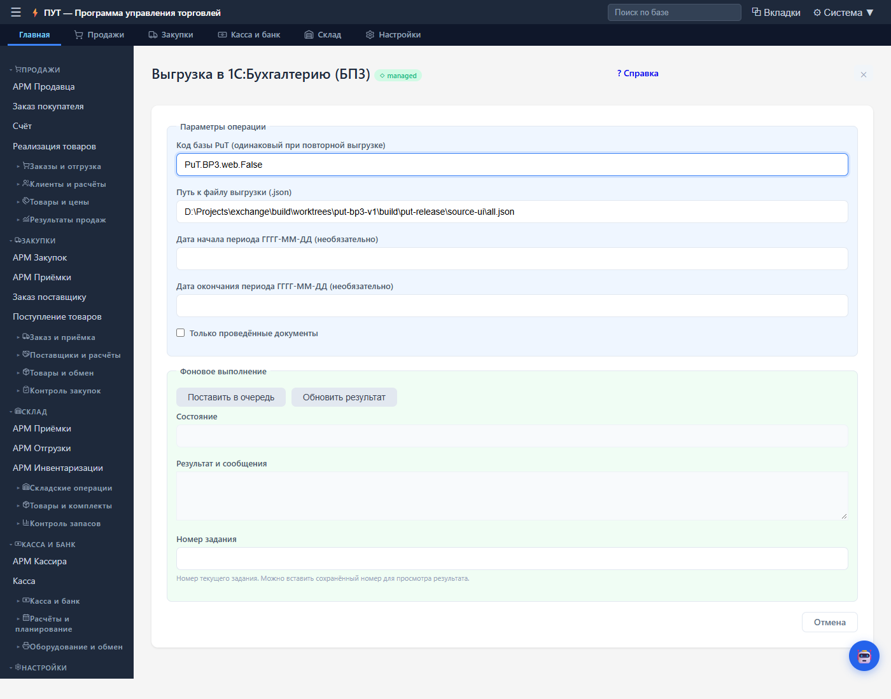
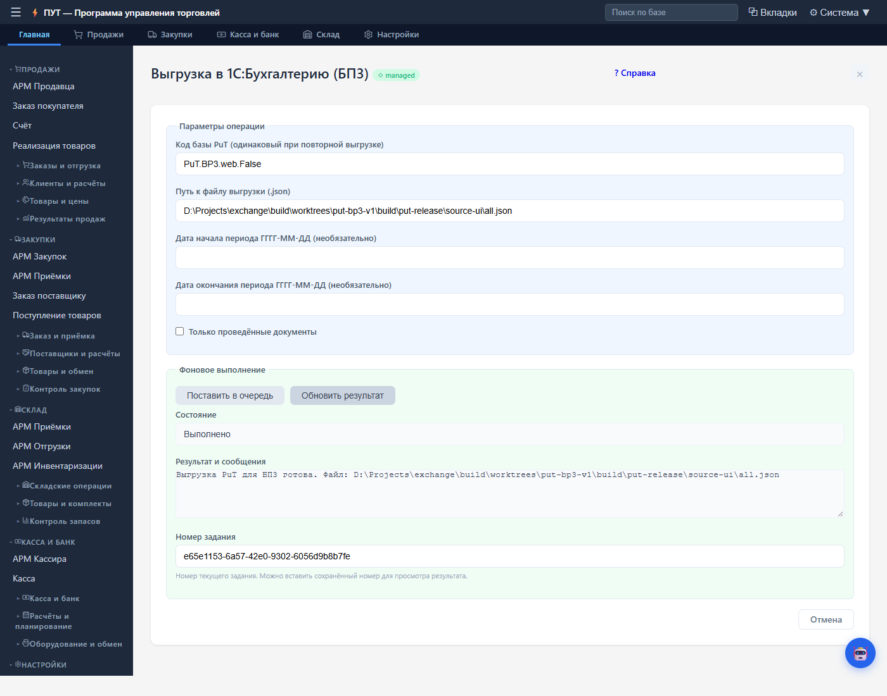
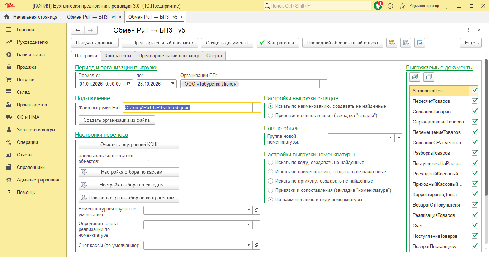
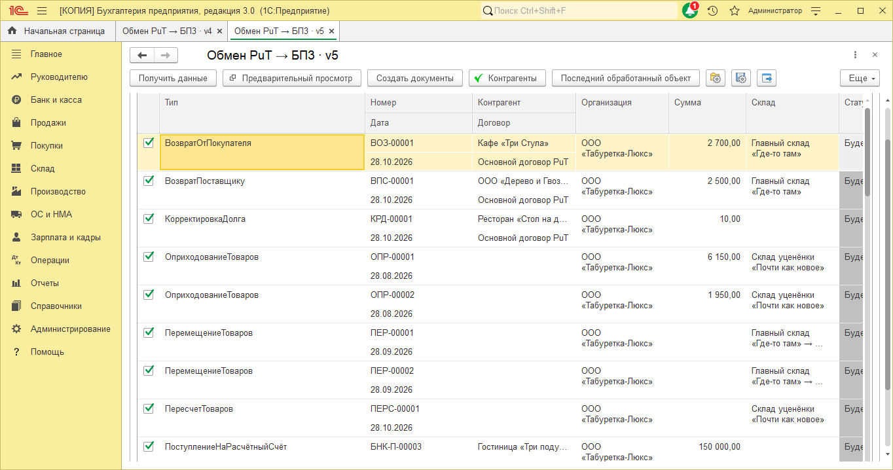
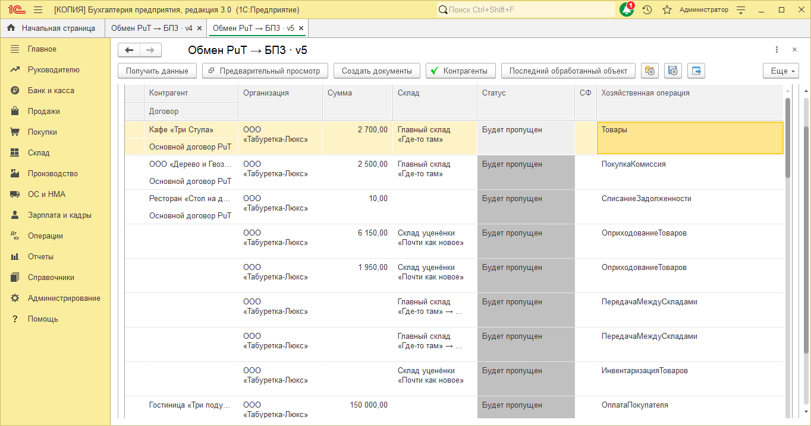

# Записать создание видео про ПУТ → БП 3

Нужно записать два разных результата: ваше видео о процессе работы с ИИ и получившийся маркетинговый ролик об обмене. Процесс можно показать примерно за 8–12 минут с ускорением ожидания. Готовый ролик ориентировочно длится 60–90 секунд.

## Перед записью

1. Откройте эту памятку, описание релиза и новый чат агента. В Zapis уже установлены CLI и навык zapis-video.
2. Проверьте Zapis командой ниже. Она проверяет локальные зависимости и не создаёт ролик.
3. Проверьте изображения ниже. Четыре кадра БП сняты заново 29 октября с v5. Два кадра OneBase показывают прежний интерфейс неизменившегося экспортёра.
4. Прослушайте голосовую пробу. В промпте выбран голос Edge Светлана. Если хотите другой голос, замените его имя и движок в промпте до записи. Сервис Edge требует интернет.
5. В программе записи включите захват окна агента и системного звука. Проверьте коротким тестом, что слышны ваш микрофон и проигрывание ролика.
6. Исходный релиз оставьте на месте. Агент создаст отдельную папку для новой сборки. Старые результаты удалять не требуется.

```powershell
& 'D:\Projects\zapis\zapis.cmd' video doctor
& 'D:\Projects\zapis\zapis.cmd' video voices --engine edge
```

Голосовую пробу можно сделать до записи. Выберите новый путь, если файл уже существует:

```powershell
& 'D:\Projects\zapis\zapis.cmd' video preview --text 'Программа управления торговлей передаёт данные в один эс. Сначала проверим документы в предпросмотре.' --engine edge --speaker ru-RU-SvetlanaNeural --output 'D:\Projects\zapis\video_runs\put-bp3-voice-check.wav'
```

## Что сказать в начале

«У меня есть готовый обмен из ПУТ на OneBase в Бухгалтерию 3.0. Сейчас попрошу ИИ сделать о нём маркетинговый ролик: с понятной проблемой, решением, настоящими экранами и голосом. Сценарий подготовит агент, а Zapis соберёт видео через командный интерфейс».

Затем покажите папку релиза v5: payload содержит PuT-BP3_v5.epf и инструкцию, evidence содержит отчёты проверок. Новые снимки для ролика находятся в assets этого комплекта. Открывать исходники EPF или демонстрировать установку зависимостей для этого рассказа не требуется.

## Порядок записи

| Этап | Что сделать | Что объяснить зрителю |
| --- | --- | --- |
| Показать задачу | Открыть релиз и 2–3 кадра из этой памятки | Исходные материалы уже есть, теперь из них получится история о продукте |
| Отправить запрос | Скопировать PROMPT.md целиком в чат агента | В запросе заданы продукт, реальные экраны, анимация, голос и итоговый формат |
| Показать работу ИИ | Дать агенту прочитать инструкцию и подготовить сценарий | Агент выделяет проблему и решение, выбирает подтверждённые возможности |
| Проверить голос | Прослушать короткую пробу, обратить внимание на ПУТ, OneBase и БП | Наличие аудиофайла ещё не означает удачное произношение |
| Посмотреть раскадровку | Открыть ссылку review из результата CLI | Заголовки читаются, кадры настоящие, предпросмотр крупный |
| Поправить по смыслу | При необходимости отправить короткую правку агенту | Например, «Сделай предпросмотр крупнее и держи его на экране дольше» |
| Собрать MP4 | Дать агенту выполнить пробу и финальную сборку | Zapis выполняет синтез и рендер, ID позволяет следить за долгой задачей |
| Показать результат | Воспроизвести ролик со звуком и перейти к сцене предпросмотра | Финальная проверка ведётся по настоящему MP4 |

Ожидание синтеза и рендера можно ускорить в монтаже, сохранив видимым факт ожидания. Не обещайте фиксированную скорость генерации, она зависит от голоса, сети и компьютера.

## Какие экраны должны попасть в ролик



Это реальная форма ПУТ на OneBase. Видны период, признак проведения и запуск фонового задания. В ней подготавливается выгрузка, предпросмотр списка документов показан в 1С.



Статус «Выполнено» показывает готовность JSON. Поле с путём относится к серверу OneBase. При работе с удалённым сервером файл отдельно доставляют на компьютер с БП.



В v5 сначала выбираются файл, организации БП, период и виды документов. Выбор файла сам по себе не заполняет сопоставления и предпросмотр.


После «Получить данные» проверяются сопоставления. На новом кадре видны организация, контрагенты обеих систем, договор, ИНН, валюта и операция.



Список формируется отдельной командой «Предварительный просмотр» после подготовки сопоставлений. В кадре видны номера, даты, организации, контрагенты, суммы и склады.



Это та же таблица после горизонтальной прокрутки. «Будет пропущен» относится к повторному файлу, документы уже загружались в демонстрационную базу. Кадр показывает проверку до создания и защиту от дублей. Создание документов в этой съёмке не запускалось.

## Если нужен новый кадр первой загрузки

Попросите агента подготовить отдельную демонстрационную копию и снять интерфейс через навыки 1С. В новом кадре должны быть настоящие статусы ожидаемых действий. Не заменяйте подписи в старом изображении.

Проверяйте источник JSON и код базы. Для повторных выгрузок из одной демонстрационной базы код должен оставаться одинаковым. На первой загрузке можно показать предполагаемое создание документов, на повторной ожидаемое пропускание. Используйте отдельный тестовый контур и снимок состояния, если нужно повторять демонстрацию.

Для ролика уже достаточно приложенных кадров. Перезагружать 42 документа ради одной иллюстрации не требуется. Если нужно показать действие живьём, заранее проверьте сценарий на демонстрационной копии.

## Короткие правки во время записи

«Сделай предпросмотр в 1С крупнее. Текст поверх таблицы убери в отдельную подпись, сцену оставь на 14 секунд».

«На повторной загрузке скажи, что существующие документы будут пропущены без перезаписи. У нас на кадре именно эти статусы».

«В произносимом тексте замени ПУТ на “программа управления торговлей”, затем дай короткую пробу этой фразы».

«Схему OneBase → JSON → Бухгалтерия показывай последовательно. Каждый следующий этап появляется в тот момент, когда диктор до него доходит».

## Перед завершением

Проверьте реальное воспроизведение MP4, голос и перемотку. На сцене предпросмотра должны читаться номера, суммы и статусы. В финале цена 15 000 ₽ относится к обмену, указаны час доработки бесплатно и контакт автора. ПУТ остаётся бесплатной.

Сохраните JSON сценария, WAV, SRT/VTT, кадры и папку результата CLI. Исходные экраны и их контрольные суммы находятся в assets/sources.json. Комплект не требует публикации EPF или автоматической загрузки видео на сайт.
